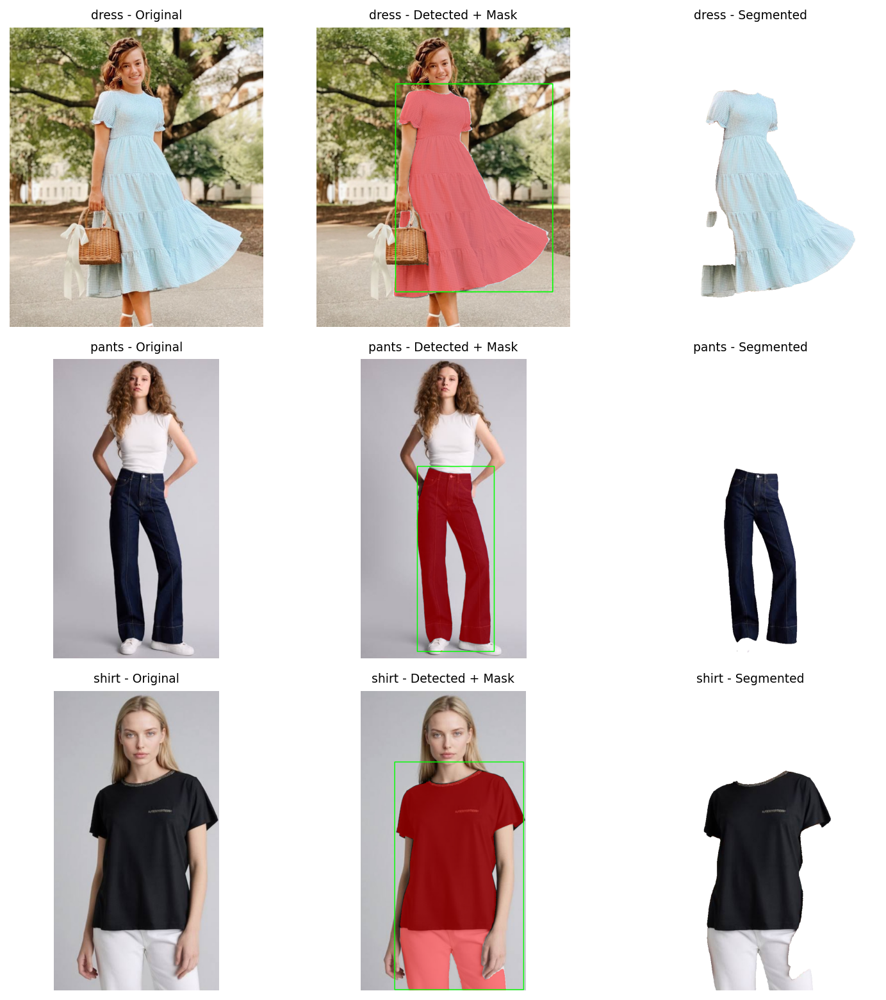

# Clothes Piece Segmentation Using SAM

Automatic segmentation of clothing items (pants, shirt, dress) from photos using a text prompt, with no manual box drawing.

## Problem
Isolating a clothing item from a photo is useful for e-commerce product images and virtual try-on. This project cuts out a clothing piece automatically from just its name.

## Pipeline
Text prompt (from file name) -> OWL-ViT detects a bounding box -> SAM predicts masks -> best mask selected -> overlay and transparent cutout saved.

## Tools
- Segment Anything Model (SAM, ViT-B)
- OWL-ViT (zero-shot object detection, Hugging Face Transformers)
- OpenCV, NumPy, Pandas, Matplotlib, Pillow
- Google Colab (T4 GPU)

## Results

| image      | prompt   |   detector_score |   sam_score |   mask_area_% |
|:-----------|:---------|-----------------:|------------:|--------------:|
| dress.jpeg | dress    |            0.628 |       0.995 |          22.1 |
| pants.jpeg | pants    |            0.291 |       0.998 |          18   |
| shirt.jpeg | shirt    |            0.084 |       0.971 |          38.9 |

Cutouts with a transparent background are in `images/cutout/`, and overlays are in `images/overlay/`.

## How to run
1. Open the notebook in Google Colab and enable a GPU runtime.
2. Run the cells in order and upload your images, naming each file after the clothing item (for example `pants.jpg`).
3. Outputs are saved in the `images/` folder.

SAM checkpoint: https://dl.fbaipublicfiles.com/segment_anything/sam_vit_b_01ec64.pth

## Notes and limitations
- Both models are pretrained. No training was done in this project.
- The SAM sco